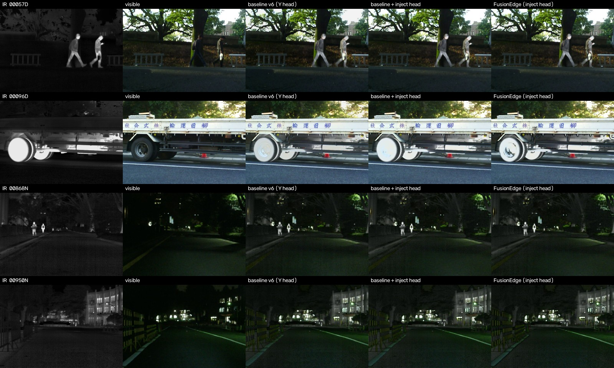

# FusionEdge: lightweight infrared + visible image fusion

I set out to build a small network that fuses an infrared image and a visible image of the same scene into one picture. The goal was to keep what each sensor is good at: thermal targets like people and engines, which can be invisible to an RGB camera at night, and the colour and texture that only the visible camera has. The target was edge hardware, so parameters and latency mattered as much as image quality.

**Summary:** I designed FusionEdge, a dual-branch fusion network with cross-modal attention and an edge-guided gate. Then I tested it properly against a plain CNN, and the plain CNN with the same output head turned out just as good, at a third of the latency (16.9 ms vs 47.0 ms per 480×640 frame) and 13k instead of 22k parameters. The part that mattered was the output head I designed along the way. The fancy backbone didn't earn its cost.



*Held-out MSRS images. Columns: infrared, visible, baseline (no inject head), baseline + inject head, FusionEdge. Rows: two day scenes, two night scenes.*

## What I'd use

**`baseline_simplecnn_inject`**: the plain baseline backbone with the inject head (`configs/baseline_inject.yaml`).
- 13,089 parameters, 16.9 ms per frame.
- Stable across three training seeds.
- Never darkens the image, and keeps the visible camera's colour exactly.

FusionEdge stays in the repo as a documented negative result. Over three seeds it trades infrared similarity for visible similarity, varies much more between seeds, and costs 1.7× the parameters and 2.8× the latency.

## Results (seed 1234, 108 held-out images)

| | baseline (Y head) | baseline + inject | FusionEdge |
|---|---|---|---|
| parameters | 13,089 | 13,089 | 22,339 |
| latency, 480×640, RTX 4070 Laptop (median) | 16.7 ms | 16.9 ms | 47.0 ms |
| MI | 3.676 | **6.275** | 6.180 |
| SSIM_vi / MS-SSIM_vi | 0.902 / 0.927 | 0.906 / 0.925 | **0.914 / 0.932** |
| SSIM_ir / MS-SSIM_ir | **0.514 / 0.500** | 0.493 / 0.486 | 0.484 / 0.475 |
| pixels darkened / brightening outside IR-brighter areas | 23.7% / 27% | 0% / 4% | 0% / 4% |
| audit / acceptance gate | 17/17, 14/14 | 17/17, 14/14 | 17/17, 14/14 |

What I took from it:

- **The output head was the real win.** Switching the baseline to the inject head stopped it darkening the scene and adding brightness where there's no thermal target. It also lifted mutual information with the sources from 3.68 to 6.27.
- **The bigger backbone didn't clearly help.** Over seeds 1234, 1235 and 1236, FusionEdge was clearly better on 3 of 8 metrics (SF, SSIM_vi, MS-SSIM_vi), the baseline + inject on 3 (MI, SSIM_ir, MS-SSIM_ir), and 2 were ties. That meets the bar I set before running the seeds for calling the backbone "not supported", though only just: the bar was 5 of 8 and the result was exactly 5.
- **The baseline without the inject head scores best on IR structure,** but it gets there by changing brightness across the whole frame.

All tables, the test-split numbers and the per-seed breakdown are in [docs/RESULTS.md](docs/RESULTS.md).

## How it works

Every model fuses **luminance only**. The colour channels (Cb/Cr) come straight from the visible image, so the network can't invent colour. An early version predicted RGB directly and painted foliage yellow and people green, which is why I switched.

The output head I ended up with:

```
g   = sigmoid(head(features))       per-pixel gate, starts at 0.5
Y   = Y_vi + g * relu(IR - Y_vi)    add part of the infrared excess, only where IR is brighter
out = recolour(Y, vi)               fused luminance + visible colour
```

I arrived at this after the first FusionEdge head, `clamp(vi + delta)`, refused to train. It started exactly at the visible image, which is a non-smooth point of the loss, and never moved. The details are in [docs/ARCHITECTURE.md](docs/ARCHITECTURE.md).

- **FusionEdge** (22,339 parameters): a shared stem and separable residual blocks for both images, squeeze-excite per branch, cross-modal attention on an 8×8 token grid, and a Sobel-edge-guided per-pixel gate between the branches.
- **Baseline** (13,089 parameters): stack IR and visible as channels, then 4 separable residual blocks and the head.

There's no ground-truth fused image, so training is unsupervised. The loss pulls intensity and gradients towards the stronger of the two sources and adds SSIM, edge-retention and colour terms (weights 8 / 10 / 2 / 1 / 1). Training settings: Adam 1e-4 with a cosine schedule, 60 epochs, batch 8, 128×128 crops, bf16 autocast with the loss in fp32.

## How I evaluated it

I wrote down the evaluation rules **before** each run in [docs/PROTOCOL.md](docs/PROTOCOL.md), so I couldn't tune them to the results:

- **Same everything:** every model uses the same data, schedule and seed.
- **Selection on a holdout:** models are compared on a holdout carved from the training set.
- **Test split once:** the official test split is evaluated once at the end and never used to choose anything.
- **Automated gates:** each run has to pass an automated audit and acceptance gate.
- **Failed runs kept:** they stay in the repo with notes on what went wrong ([docs/EXPERIMENTS.md](docs/EXPERIMENTS.md)).

Doing it this way caught real bugs before they could produce misleading numbers:
- a precision issue that quietly corrupted the loss gradients;
- TF32 making "fp32" numbers non-reproducible;
- a data-loader seed that made different training seeds see identical batches.

## Dataset

**MSRS** ("MSRS: Multi-Spectral Road Scenarios for Practical Infrared and Visible Image Fusion", Tang et al.), downloaded from the authors' repository `github.com/Linfeng-Tang/MSRS` at commit `5fa66e33c5ba`. My provenance record notes "Research use; cite the original paper". The images aren't included here; `scripts/download_data.py` fetches them.

| split | pairs | used for |
|---|---|---|
| `train/` minus holdout | 975 | training |
| holdout (10% of `train/`, fixed by hash) | 108 | picking and comparing models (everything in this README) |
| `test/` | 361 | one final evaluation per run |

More in [docs/DATASET.md](docs/DATASET.md).

## Running it

Tested on Windows, Python 3.14.5, PyTorch 2.12.1+cu126 and an RTX 4070 Laptop GPU ([docs/ENVIRONMENT.md](docs/ENVIRONMENT.md)). The pinned torch builds come from the PyTorch index:

```bash
pip install -r requirements.txt --extra-index-url https://download.pytorch.org/whl/cu126
python scripts/download_data.py --dataset msrs
python scripts/download_data.py --verify-only
python -m pytest -q
```

If you're not on CUDA 12.6, install a matching torch/torchvision first ([pytorch.org](https://pytorch.org/get-started/locally/)). On a fresh clone, `--dataset msrs` re-downloads MSRS and updates the local path in `data/registry/MSRS.json`.

**Fuse an image pair.** Trained weights for the recommended model are attached to the [v1.0 release](https://github.com/ScholarlyAdeeb/FusionEdge/releases/tag/v1.0). Put `baseline_simplecnn_inject_last.pt` at `experiments/baseline_simplecnn_inject/checkpoints/last.pt`, or train it yourself (below). Then:

```bash
python scripts/infer.py --run experiments/baseline_simplecnn_inject --fp32 --ir data/MSRS/canonical/train/ir/00096D.png --vi data/MSRS/canonical/train/vi/00096D.png --out results/demo/baseline_inject_00096D.png
```

The script refuses checkpoints that look untrained, because an untrained model still produces a convincing-looking blend.

**Train and evaluate:**

```bash
python scripts/run_experiment.py --config configs/baseline_inject.yaml
```

This trains for 60 epochs, about 35–45 minutes on the laptop GPU, then evaluates once on the test split and benchmarks the model. On Windows, `scripts\win\protocol_run.ps1 -Run <run_name> -Cfg <config>` wraps the same run with the tests, a pre-flight check, the audit and the acceptance gate. It also refuses to overwrite an existing run, which `run_experiment.py` alone doesn't. To regenerate the comparison afterwards:

```bash
python scripts/analyse_fusion.py experiments/baseline_simplecnn_inject experiments/fusionedge_main experiments/baseline_simplecnn_v6
python scripts/make_results.py --analysis results/analysis/<folder printed above>
```

## Limitations

- **Few seeds.** Three seeds for the two inject-head models, one for the plain baseline. That's enough for the rule I set, but the spread estimates are rough, and the verdict landed exactly on the threshold.
- **The head can only brighten.** Very hot objects lose their visible texture: the truck wheels in the example become near-white discs. At night it also brings in some IR sensor grain on the road.
- **No ground truth, so no metric measures "correct".** My AG and SF definitions also differ from the published MSRS tables, so those numbers aren't comparable with papers.
- **No comparison against published fusion methods,** and the seven planned FusionEdge ablations haven't been run.
- **Latency measured on one laptop GPU,** not a phone or NPU, and not broken down per module.

## Repository layout

| path | contents |
|---|---|
| `fusionedge/models/` | FusionEdge, the baseline, and the shared inject head (`colour.py`) |
| `fusionedge/losses/`, `fusionedge/metrics/` | training loss; EN / AG / SF / MI / SSIM / MS-SSIM |
| `fusionedge/engine/` | training, evaluation, benchmarking, inference |
| `scripts/` | experiment runner, audit, acceptance gate, analysis, doc generators, Windows launchers |
| `configs/` | shared defaults plus one file per run |
| `docs/` | protocol, results, architecture, experiment list, dataset, environment, dev log |
| `experiments/` | per-run configs, logs and metrics (checkpoints aren't committed); `_failed/` keeps failed runs |
| `results/` | audit and gate outputs, analyses |

Licensed under MIT ([LICENSE](LICENSE)). MSRS has its own terms; see above.
